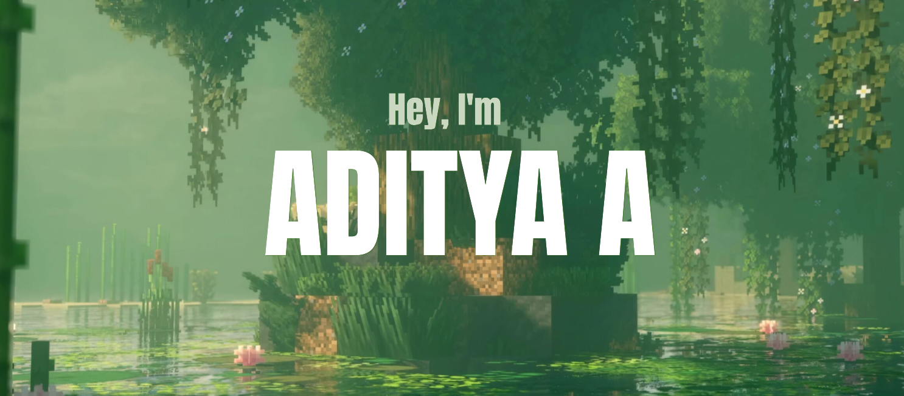
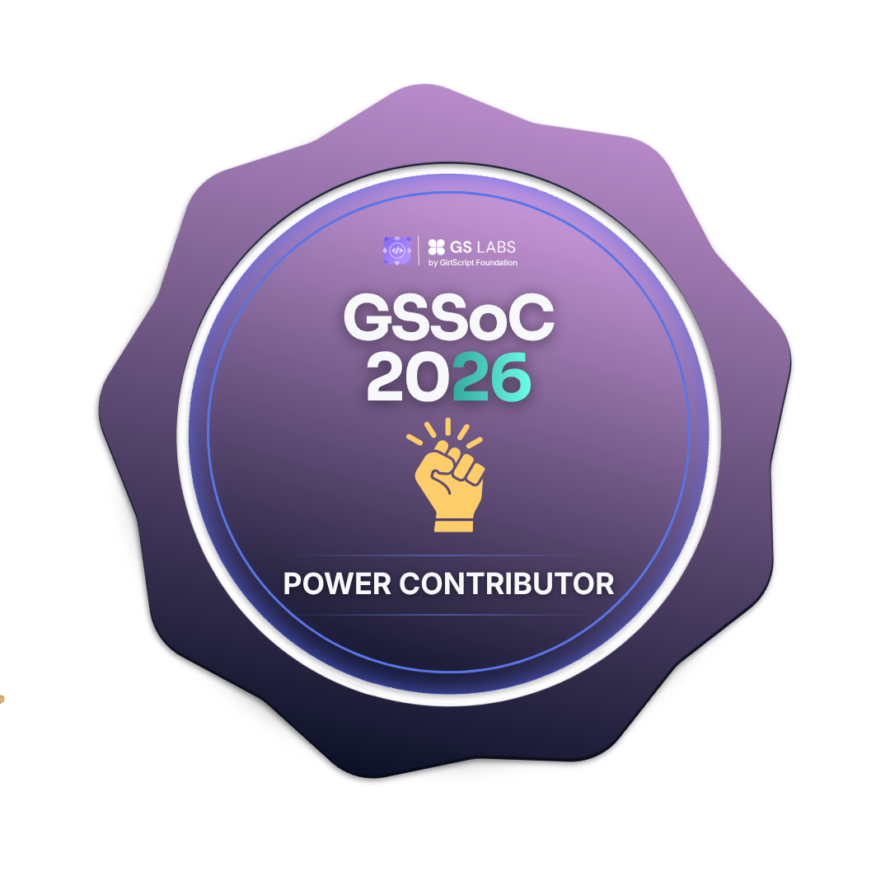
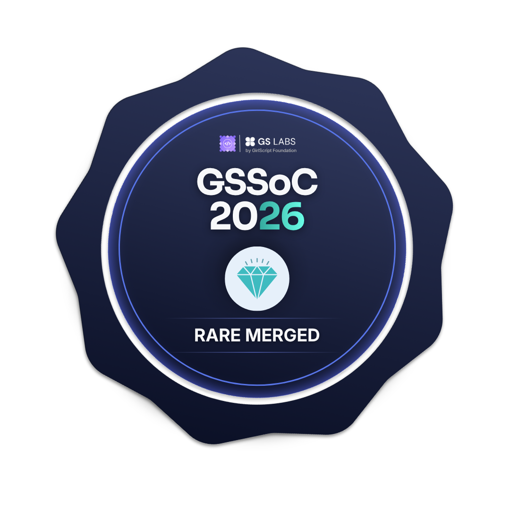
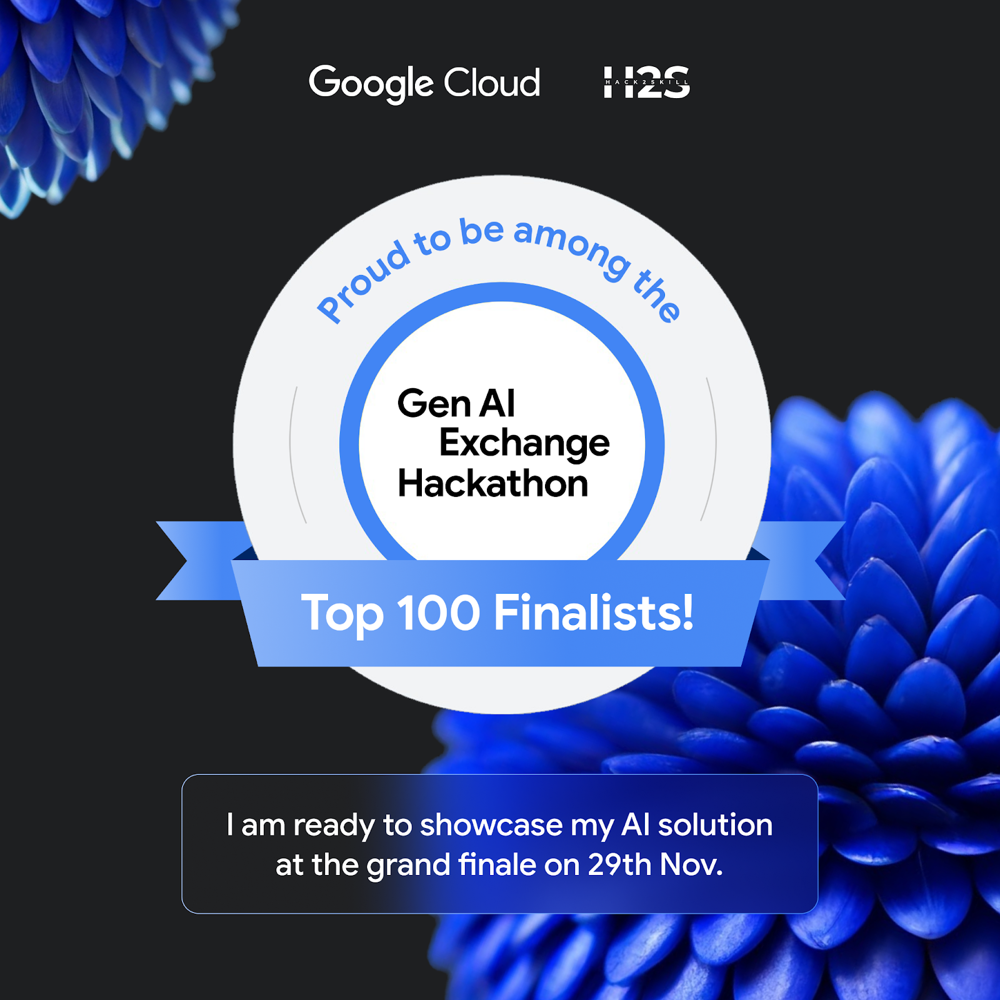

### 🌿 Computer Science Student & Software Developer

🏢 Ex-SWE Intern **@theMonks.tech** &nbsp;|&nbsp; 🏆 Google Cloud Gen AI Hackathon **3rd Runner Up** &nbsp;|&nbsp; 💼 **[Portfolio](https://aditya-a-portfolio.vercel.app)** &nbsp;|&nbsp; 💻 **[Projects](https://github.com/theblag?tab=repositories)** &nbsp;|&nbsp; 📫 **[Email](mailto:adityaarun2006@gmail.com)**

 

 

  

 

 

 

 

  

 

  

  
  
  <!--  -->
  

  

<!-- 
 

  

### ☁️ Cloud & Certifications

  
  
  

### 💻 Open Source (GSSoC)

  
  
  

### 🌟 Hackathons & Community

  
  

   -->

 

  

  

 

  

